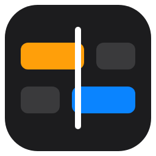

# ResolveCollab

Work on the same DaVinci Resolve project together, live, from different PCs.

ResolveCollab keeps your media pool, timelines and markers in sync between everyone in a session, shows who is where, lets you chat and follow each other, and fetches the media someone else has. It works with genuine **DaVinci Resolve 21.1 or later, Free or Studio**, on Windows.



## What it does

- **Live sync** of the media pool (bins, clips, names, colours, flags, metadata), timelines (tracks, clips, positions, trims, speed, fades, transitions, titles and Text+) and markers (on timelines, timeline clips and media pool clips). Changes reach the others in about a second.
- **Sessions:** one person hosts, the others join with an invite code. The host lets each PC in, can remove and block PCs, and can resume the session later with a new code.
- **Working at the same time:** when two people change the same thing at once, the first to reach the host wins and the other is told, with a button to send theirs again. **Ctrl+Z** undoes only your own changes. Changes made while offline are merged when you're back, and you're asked only about real clashes.
- **A small window that stays on top of Resolve:** a chat bar at the bottom right that expands into a strip with **Chat** and **Changes**. Click a timecode or a change to jump there.
- **Presence and Follow:** see who is on which page and timeline; click someone to follow their playhead, page and timeline.
- **Ghost cursors:** see the others' mouse pointers over your Resolve, placed on the same panel, and on the Edit page's timeline at the same frame and track, even when your layout or zoom differs.
- **Media:** a clip you don't have gets a small proxy automatically (half size, up to 1080p), sent by a PC that has the original; the full-quality original comes when you ask. The Media panel shows every clip's first frame in a grid, like Resolve's media pool.

## Installing

1. Download **`ResolveCollab-Setup-<version>.exe`** from [Releases](https://github.com/jcng1026/resolve-collab/releases).
2. Run it. It isn't code-signed, so Windows shows "Windows protected your PC": click **More info → Run anyway**. It installs for your Windows user only and needs no admin rights.
3. Start **ResolveCollab** from the Start menu. It puts its script into Resolve by itself. The first time, **restart Resolve**, then in Resolve choose **Workspace → Scripts → ResolveCollab**. The card in ResolveCollab turns green when Resolve answers.

Everyone in a session should run the same version; ResolveCollab warns you if they don't.

**Updating:** run a newer installer over the old one; your sessions, settings and downloaded media are kept. **Uninstalling** (Settings → Apps) removes the app and its script in Resolve, and keeps your sessions and media.

## Using it

- **Host:** open your project in Resolve, then in ResolveCollab enter your name and click **Start a session**. Open **⋯ → Session and invite code**, copy the code and send it to the others.
- **Join:** click **Join**, paste the code, click **Join**. The host lets you in. The first time, ResolveCollab makes a new project for the session in your Resolve and fills it in.
- **In the chat box,** type `/` for commands: `/timestamp` (your playhead's timecode), `/follow <name>`, `/stop`, `/undo`, `/redo`, `/invite`, `/leave`.
- **Media:** the first time a clip is missing, you're asked where downloaded media goes (by default `Videos\ResolveCollab\<project>`). You can change it later in Settings.

## Requirements

- Windows 10 or 11, 64-bit.
- DaVinci Resolve 21.1 or later, Free or Studio (genuine).
- An internet connection: PCs find each other over the public Hyperswarm network and then talk directly, end-to-end encrypted.

## Privacy and security

- Nothing is sent anywhere except to the people in your session. There is no telemetry and no server of ours.
- The invite code is a 128-bit secret; every connection is end-to-end encrypted. The host approves every PC.
- PCs exchange data, never code. Every message from another PC is checked before it's used, and downloaded files can only be written inside your media folder.
- Logs stay on your PC (`%USERPROFILE%\ResolveCollab\logs`, kept 14 days).
- Only let people you trust into a session: they can change the shared project, and Resolve opens the media files they send.

The full review is in [docs/security-review.md](docs/security-review.md).

## Known limits

- Windows only.
- The Color, Fusion and Fairlight pages aren't synced yet (planned).
- The installer isn't code-signed, so Windows warns when installing.
- Ghost cursors are matched by frame and track on the Edit page's timeline; on other pages, by panel.
- Each media file comes from one PC at a time.

## Building from source

Needs Node.js 24 or later, and for the installer [Inno Setup 6](https://jrsoftware.org/isinfo.php).

```bash
npm install
npm run check            # type check and tests
node src/companion.ts    # run the app from the source
```

From the source, put the script into Resolve yourself with `node tools/install-bridge.ts`.

To build the installer:

1. Put an LGPL build of ffmpeg (`ffmpeg.exe`, `ffprobe.exe` and their DLLs) in `vendor\ffmpeg`. Releases use [BtbN's `ffmpeg-n9.0-latest-win64-lgpl-shared`](https://github.com/BtbN/FFmpeg-Builds/releases).
2. Run `node tools/build-release.ts`. The installer is written to `dist\`.

How it's designed, milestone by milestone, is in [docs/SPEC.md](docs/SPEC.md).

## Third-party software

- **FFmpeg** (LGPL v3), bundled in the installer as `ffmpeg\`, unmodified, from [BtbN/FFmpeg-Builds](https://github.com/BtbN/FFmpeg-Builds). Its licence is in `ffmpeg\LICENSE.txt`; its source code is at [ffmpeg.org](https://ffmpeg.org/download.html) and [git.ffmpeg.org](https://git.ffmpeg.org/ffmpeg.git).
- **Electron** (MIT), the app's window and runtime.
- **Hyperswarm** and its packages (MIT), the peer-to-peer connection.

DaVinci Resolve is a trademark of Blackmagic Design. ResolveCollab isn't made or endorsed by Blackmagic Design.

## Licence

[MIT](LICENSE). The bundled FFmpeg keeps its own licence (LGPL v3, above).
